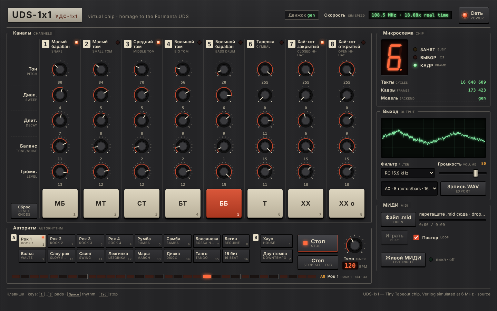
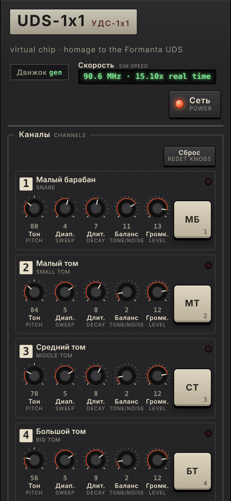

# UDS-1x1 Virtual

**Live: https://ai-wrangler.github.io/uds-virtual/** (Chrome or Edge on a desktop)

A virtual drum machine in the browser that runs the real chip. Knobs, pads, Autorhythm patterns, MIDI files
and live MIDI drive the Verilog of the [UDS-1x1](https://github.com/ai-wrangler/tt-uds-1x1) Tiny Tapeout chip,
simulated clock by clock at 6 MHz in WebAssembly. The chip's 1-bit sigma-delta audio pin goes through a model
of the Audio Pmod to your speakers.

UDS-1x1 is a digital homage to the Soviet Formanta UDS drum synthesizer: two voices, eight drums, SPI control.
Every sound you hear is the count of 1s the simulated chip put on its audio pin, frame by frame.





## Status

<!-- STATUS:BEGIN -->
_Final report from the integration session, night of 17–18 October 2026, about 00:00 Riga time._

**URL: https://ai-wrangler.github.io/uds-virtual/** (Chrome or Edge, desktop). Deployed from `main` by GitHub Actions; every merge redeploys.

**What works** (verified on the live site with the real engine):
- The chip's real Verilog (`chip/src/*.v`) runs clock by clock at 6 MHz in WebAssembly (backend `gen`: Yosys netlist → straight-line C++ → zig wasm32, 91 KB) in a Worker; its 1-bit audio pin goes through the Audio Pmod model (frame count, AC coupling, RC 15.9 kHz, resampler) to an AudioWorklet.
- Power on, 8 pads (mouse or keys 1..8), 40 knobs, the 7-segment display driven by the chip's own `uo_out` pins.
- Autorhythm as 16 slots: load a `.mid` groove into a slot, quantized and looped, tempo knob 40..240. (The ui session replaced the 18 pattern buttons with slots and made the panel English-only, citing Juris's request; the built-in Formanta patterns remain in the API, `uds.setPattern('A0')`.)
- MIDI file player (GM drums on channel 10, loop), live Web MIDI input, filter RC / Warm / Off, volume with a soft limiter, offline WAV export.

**Test results** (CI green on `main`):
- Engine model check: 316 185 frames, 2 208 SPI messages, **0 frames differ** from `chip/model/uds_model.py`. Cross-check gen = CXXRTL on every pin for 10 004 294 clocks.
- Browser truth test on the live site: the deployed engine replays the model fixture, **22 019 frames, 0 mismatches**.
- e2e against the live site: **38/38 passed (mock and real engine)**. Locally: Node **44/44 (engine 13, audio 31)**, Playwright **67/67** (e2e, ui, audio projects).

**Simulation speed** (2.8 GHz Xeon cloud vCPU; real time = 6 MHz): engine alone 152 MHz in Node, 165–169 MHz in headless Chromium (25–28x); the live page while playing reports **104–127 MHz** in `status.simHz` (17–21x real time). On a Ryzen 7 8845HS expect the same or better, roughly 25–40x real time: lots of headroom.

**Known gaps**
- Not yet measured on Juris's laptop or with real speakers/headphones; all audio checks are analyser/WAV based in headless Chromium.
- Live MIDI is tested only through the code path (no MIDI device in CI).
- `hit`/`step` events (pad LEDs, display) fire when the worklet plays the sample, without the device output latency (~10–20 ms on Windows).
- The 18 built-in patterns are no longer on the panel (API only), after the slots change.
- If the engine ever runs below real time (battery saver), music slows and audio gaps appear; the speed readout turns amber/red and WAV export still works.
- One audio-suite timing test (`a MIDI fixture plays`) measures wall-clock event times and can flake under heavy CPU load; CI retries once.
- Mobile layout works but the target is desktop Chrome/Edge.

**What to try first on the laptop**
1. Open the URL in Chrome or Edge, click **Power**, check the header: `Engine gen` and a speed of 20x real time or more.
2. Hit the pads with keys **1..8**; watch the 7-segment display show 0..7 (that's the chip's pins).
3. Click Autorhythm slot 1, load `app/data/midi/demo.mid` from the repo (or any GM drum `.mid`), press **Space**; turn the Tempo knob and the knobs of the playing drums.
4. Switch **Filter** to Off to hear the raw 1-bit sigma-delta stream, then back to RC 15.9 kHz.
5. Plug in a MIDI keyboard or pad controller and click **Live MIDI**.
6. **Export WAV** and listen to the file.

<!-- STATUS:END -->

## How to use it

1. **Power on.** Click **Power** (or the **Power on** overlay). Browsers only start audio after a click.
   The header shows the engine (`gen` = the real chip) and the simulation speed, e.g.
   `109.2 MHz · 18.21x real time`.
2. **Pads.** Click a pad or press **1..8**: SD snare, HT small tom, MT middle tom, LT big tom, BD bass drum,
   CY cymbal, CH closed hi-hat, OH open hi-hat. Pad n is chip channel n−1 (shown as "ch 0".."ch 7"); the
   7-segment display shows the chip's own output pins: the channel last hit (0..7).
3. **Knobs.** Each channel has Pitch, Sweep, Decay, Tone/noise and Level. Drag up/down, use the mouse wheel
   or arrow keys (Shift = fine), double-click for the default. The next hit of that channel uses the new
   values. **Reset knobs** restores the defaults.
4. **Autorhythm: 16 slots.** Click an empty slot (or drop a `.mid` on it) to load a drum groove from your
   computer; it is quantized to 16ths and looped (up to 4 bars), at the file's tempo. Try
   [`app/data/midi/demo.mid`](app/data/midi/demo.mid). Select a slot, then **Start** or **Space**; switching
   slots while playing changes at the next bar line. **Tempo** knob 40..240 bpm. **Stop all** or **Esc**
   stops everything. Slots are remembered in this browser. (The 18 built-in Formanta patterns are still in
   the API: `uds.setPattern('A0')`.)
5. **MIDI file.** **Open .mid**, or drop a `.mid` elsewhere on the page, then **Play**. General MIDI drum
   notes on channel 10 are mapped to the eight drums; other notes are counted as unmapped. **Loop** repeats.
6. **Live MIDI.** **Live MIDI** asks for Web MIDI access; then any note-on from a connected keyboard or pad
   controller plays (velocity sets the level).
7. **Filter and volume.** RC 15.9 kHz (the Audio Pmod's real filter), Warm 4 kHz, or Off (the raw 1-bit
   stream, harsh). Volume is the master gain; a soft limiter above 0.8 prevents hard clipping.
8. **Export WAV.** Renders 8 bars of the selected slot (or the MIDI file) offline with a separate engine and
   downloads a 16-bit WAV. This works even on a machine too slow for real time.

URL flags: `?engine=mock` uses a plain-JS model instead of the chip; `?fake=1` is the ui's silent demo.

## Architecture

```
 knobs, pads, patterns,          main thread                  dedicated Worker                      audio thread
 MIDI file, live MIDI   ──▶  UDSAudio (app/audio)  ──msg──▶  engine-worker.js                      player-worklet.js
 (app/ui panel)                 events ◀──────────────────  ├ rhythm + MIDI sequencer             (AudioWorklet)
                                                            ├ uds_engine.wasm  ◀── chip/src/*.v      chunk FIFO
                                                            │   Verilog → Yosys → gen.py → C++ →        │
                                                            │   zig wasm32: the chip at 6 MHz,          ▼
                                                            │   virtual RP2040 (SPI), Audio Pmod     GainNode → Analyser
                                                            └ 1-bit pin → RC filter → 48 kHz ──────▶    → speakers
                                                                          (MessagePort, transferred chunks)
```

- **Engine** (`engine/`, `app/engine/`): Yosys flattens the chip's Verilog; `engine/gen.py` turns the netlist
  into straight-line C++ (one `step()` per clock, idle frames unrolled with the voice-window counters folded
  in); zig compiles it with the harness (virtual RP2040 sending SPI messages, Audio Pmod: per-frame count,
  AC coupling, RC low-pass, windowed-sinc resampler) to a 91 KB WebAssembly module. Details:
  [engine/README.md](engine/README.md).
- **Audio** (`app/audio/`): `UDSAudio` runs the engine in a Worker about 40-60 ms ahead of the speakers, splits
  `render()` at exact event samples (so rhythm and MIDI hits are sample-accurate), and streams chunks to an
  AudioWorklet. No SharedArrayBuffer (GitHub Pages cannot send COOP/COEP). Details:
  [app/audio/README.md](app/audio/README.md).
- **UI** (`app/ui/`, `app/index.html`): the Formanta-style panel, plain ES modules, no build step.
- The interfaces between the parts are in [CONTRACT.md](CONTRACT.md).

## How it is verified

| Check | What it proves | Where |
| --- | --- | --- |
| Model check | 316 185 frames, 2 208 SPI messages: per-frame count of 1s on the audio pin from the WASM engine = `chip/model/uds_model.py`, 0 frames differ (all channels, parameter corners, voice stealing, hi-hat group, STOP, back-to-back HITs) | `engine/test/model.test.mjs` |
| Cross-check | the shipped `gen` backend = Yosys CXXRTL on `uo_out`/`uio_out` for 10 004 294 clocks of random SPI traffic | `engine/test/cross.test.mjs` |
| Browser truth test | in Chromium, the deployed `uds-engine.js` replays `engine/test/fixtures/model_frames.json`: 22 019 frames, 0 mismatches with the model | `tests/e2e/truth.spec.mjs` |
| End-to-end | with the mock and the real engine: power on, pad → `hit` event + analyser RMS, all 8 pads → 7-segment table 0x3F..0x07 (and `status.uoOut`), Autorhythm slot load → steps within ±5% at 120 and 180 bpm, per-hit velocity, slots survive a reload, MIDI file upload + play, filter and volume change the output, knobs, `simHz` > 0, non-silent WAV export and download, no console errors | `tests/e2e/*.spec.mjs` |
| Part suites | audio (Node: sequencer, MIDI parser, WAV, mock; Chromium: timing, degrade paths), ui (every test hook, knobs, keys, layout), engine (API, Chromium main thread / Worker / AudioWorklet) | `tests/audio`, `tests/ui`, `engine/test` |

CI (`.github/workflows/ci.yml`) runs all of it on every PR and on main; `pages.yml` deploys `app/` on every
push to main. Run locally:

```sh
npm ci
node --test engine/test/*.test.mjs tests/audio/*.test.mjs     # needs python3
npx playwright test                                            # e2e + ui + audio, headless Chromium
UDS_BASE_URL=https://ai-wrangler.github.io/uds-virtual/ npx playwright test --project=e2e   # against the live site
python3 -m http.server -d app 8000                             # then open http://localhost:8000/
```

## Simulation speed

Real time is 6 MHz of chip clock. Measured on a 2.8 GHz Xeon cloud vCPU:

| Where | Speed | Real time |
| --- | --- | --- |
| Node 22, engine benchmark | 152 MHz | 25x |
| Headless Chromium, engine alone (main thread / Worker) | 165 / 169 MHz | 27-28x |
| Headless Chromium, the live page while playing (`status.simHz`) | 90-120 MHz | 15-20x |
| Per-clock path (while an SPI message is on the bus, ~400 clocks per HIT) | ~26 MHz | 4x |

On a **Ryzen 7 8845HS** (Zen 4, up to 5.1 GHz) expect the same or better: roughly 150-250 MHz in the Worker,
i.e. 25-40x real time. The audio needs 1x; the rest is headroom. The header's speed readout turns amber below
1.2x and red below 1.0x; if that ever happens (battery saver, a busy machine), use WAV export.

## Known gaps

See **Known gaps** in the Status section above.

## Layout

| Path | What |
| --- | --- |
| `chip/` | the chip: Verilog, Python reference model, cocotb test (read-only copy of tt-uds-1x1 at ba09c49) |
| `engine/` | Verilog to WebAssembly: netlist-to-C++ generator, harness (virtual RP2040 and Audio Pmod), tests |
| `app/` | the site: `index.html`, `ui/`, `audio/`, `engine/`, `data/` (served as is, no build step) |
| `tools/` | helper scripts, such as the pattern export |
| `tests/` | `e2e/` end-to-end, `audio/`, `ui/` part tests |
| `docs/` | briefs for the build sessions, screenshots |

## Credits and licenses

- Chip design, Python model and the original idea: Juris Vitols ([ai-wrangler](https://github.com/ai-wrangler)),
  [tt-uds-1x1](https://github.com/ai-wrangler/tt-uds-1x1), after the Formanta UDS (USSR, 1980s).
- Built on 17 October 2026 at a hackathon by four parallel Claude sessions (engine, audio, ui, integrate).
- Code: Apache-2.0 ([LICENSE](LICENSE)).
- `engine/third_party/cxxrtl/`: Yosys CXXRTL runtime headers, ISC ([COPYING](engine/third_party/cxxrtl/COPYING)),
  used for the reference backend. Build tools (not shipped): Yosys (ISC), zig (MIT).
- No third-party code is loaded at run time; fonts are the system's (Bahnschrift on Windows).
- `app/data/midi/demo.mid` is an original groove made for this project.
